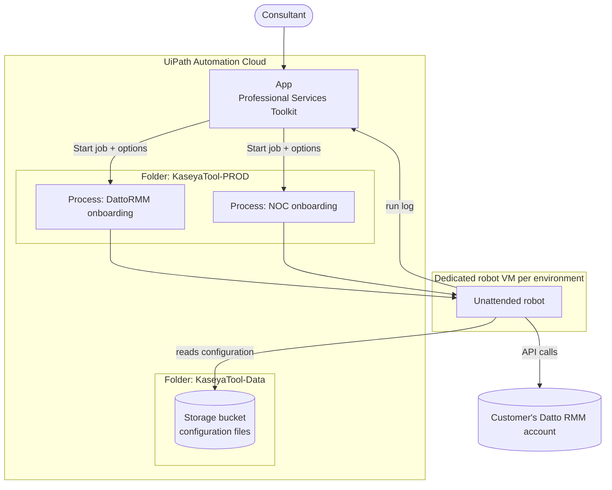

# Architecture

How the Professional Services Toolkit is built. For developers and administrators.

---

## Overview

1. The consultant opens the **app** and chooses the options.
2. The app starts the **process** in the environment's folder and passes the options as arguments.
3. An **unattended robot** on a dedicated virtual machine picks up the job.
4. The robot reads the standard configuration (JSON files) from the **storage bucket**.
5. The robot creates the items in the customer's **Datto RMM** account through the API, skipping items that already exist.
6. The run log is returned to the app.

---

## Environments

| | DEV | TEST | PROD |
|---|---|---|---|
| **Folder** | KaseyaTool-DEV | KaseyaTool-TEST | KaseyaTool-PROD |
| **Purpose** | Development | Testing before release | Live onboardings |
| **Receives** | Direct deploys from Studio Web | Packaged versions | Packaged versions |
| **Robot** | Own VM | Own VM | Own VM |
| **Data bucket** | Non-production | Non-production | Live |

Each environment has its **own robot machine**, so a test in DEV or TEST never affects PROD, and all three can run at the same time.

All environments are deployed from **one solution package**. A new version is published once and promoted with *Change version*. See [Release process](release-process.md).

---

## Components

### DattoRMM process

| Workflow | Role |
|---|---|
| `Run-All.xaml` | Entry point. Runs the selected options in the right order and builds the run log |
| `UpdateUdfLabels.xaml` | Sets the UDF labels |
| `CreateSiteGroups.xaml` | Creates site groups |
| `GetSites.xaml` | Reads the sites of the account |
| `CreateDeviceGroups.xaml` | Creates device groups |
| `CreateFilters.xaml` | Creates device filters |
| `CreateComStore.xaml` | Installs components |
| `CreatePolicies.xaml` | Creates policies |
| `CreateJobs.xaml` | Creates scheduled jobs |
| `CreateReports.xaml` | Creates scheduled reports |
| `CreateDashboards.xaml` | Creates dashboards |

Every *Create* workflow first checks whether the item already exists and skips it if so.

### NOC process

A separate process with its own `Run-All`. It reuses the DattoRMM workflows for UDF labels, filters and policies with NOC data from a separate bucket, and adds `CreateSecurityLevels.xaml`. See the [NOC branch](https://github.com/NeroTk345/Testing-Uipath-Issues/tree/NOC).

---

## Process arguments

| Argument | Type | Description |
|---|---|---|
| `in_UdfLabels`, `in_SiteGroups`, `in_Filters`, `in_DeviceGroups`, `in_ComStore`, `in_Policies`, `in_Jobs`, `in_Reports`, `in_Dashboards` | Boolean | Which options to run |
| `in_Platform` | String | Datto RMM platform, for example `Pinotage` |
| `in_Token` | String | API token of the customer's account |
| `in_K365` | Boolean | Adds the K365 configuration on top of Base |
| `out_RunLog` | String | Run log shown in the app |

---

## Licences

| Licence | Used by |
|---|---|
| Production (Unattended) | PROD robot, DEV robot |
| Testing | TEST robot (allowed for non-production processes) |
| Basic (user) | Consultants using the app |

---

## Planned improvements

- Store the API token as an Orchestrator credential asset instead of a job argument, so it is never visible in job details.
- Persist run history (who, when, which account, result) for later reference.
- Move the app into the solution package, so app and automation are released together.
- Configurable UDF start number for the UDF label import.
