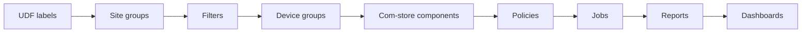

# DattoRMM options reference

What each option in the DattoRMM page does, in the order the automation runs them.

> General documentation (user guide, troubleshooting, release process) is on the [main branch](https://github.com/NeroTk345/Testing-Uipath-Issues/tree/main/docs).

---

## Run order

The automation always runs the selected options in this order, regardless of the order in which you tick them:

Items that already exist are skipped. You can safely run an option again, for example after a failed run.

---

## Options

### UDF labels

| | |
|---|---|
| **Creates** | Names (labels) for the user-defined fields of the account |
| **Workflow** | `UpdateUdfLabels.xaml` |
| **K365** | Adds the K365 labels on top of the Base labels |
| **Watch out** | Uses fixed UDF numbers. If the customer already uses some UDFs, their labels can be overwritten. A configurable start number is planned. |

### Site groups

| | |
|---|---|
| **Creates** | Site groups used to group and filter sites |
| **Workflow** | `CreateSiteGroups.xaml` |
| **Skips** | Site groups with a name that already exists |

### Filters

| | |
|---|---|
| **Creates** | The standard device filters |
| **Workflow** | `CreateFilters.xaml` |
| **Skips** | Filters with a name that already exists |

### Device groups

| | |
|---|---|
| **Creates** | The standard device groups |
| **Workflow** | `CreateDeviceGroups.xaml` |
| **Skips** | Device groups with a name that already exists |

### Com-store components

| | |
|---|---|
| **Creates** | Components from the Datto component store, plus our own components |
| **Workflow** | `CreateComStore.xaml` |
| **Watch out** | Components are used by policies and jobs, so run this before Policies and Jobs on a new account |

### Policies

| | |
|---|---|
| **Creates** | Monitoring and maintenance policies |
| **Workflow** | `CreatePolicies.xaml` |
| **Skips** | Policies with a name that already exists |

### Jobs

| | |
|---|---|
| **Creates** | Scheduled jobs |
| **Workflow** | `CreateJobs.xaml` |
| **Skips** | Jobs with a name that already exists |

### Reports

| | |
|---|---|
| **Creates** | Scheduled reports |
| **Workflow** | `CreateReports.xaml` |

### Dashboards

| | |
|---|---|
| **Creates** | The standard dashboards |
| **Workflow** | `CreateDashboards.xaml` |
| **Skips** | Dashboards with a name that already exists |

---

## Base vs Base + K365

| Configuration | What you get |
|---|---|
| **Base** | The standard best-practice configuration |
| **Base + K365** | Everything in Base, plus the extra items for customers who bought the K365 add-on |

K365 is all-or-nothing: it adds the K365 items to every option you selected.

---

## Something missing?

Missing an option, or does an option create the wrong thing? Open an [Idea](https://github.com/NeroTk345/Testing-Uipath-Issues/issues/new?template=idea.yml) or a [Bug](https://github.com/NeroTk345/Testing-Uipath-Issues/issues/new?template=bug.yml) and choose product **DattoRMM**.
