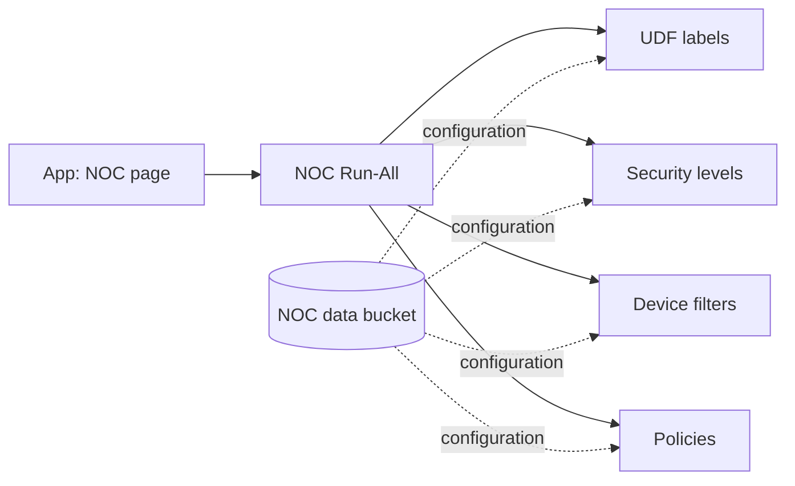

# NOC reference

What the NOC process does, how it is built, and how security levels work.

> General documentation (user guide, troubleshooting, release process) is on the [main branch](https://github.com/NeroTk345/Testing-Uipath-Issues/tree/main/docs).

---

## What NOC is

**Kaseya NOC Services** provides 24/7 monitoring and management by Kaseya's NOC team. Before the NOC team can work in a customer's Datto RMM account, the account needs a standard NOC configuration. This process sets that up.

NOC is a **separate product and process** from DattoRMM. It has its own `Run-All` and its own configuration data.

---

## How it is built

- **UDF labels, device filters and policies** reuse the same workflows as DattoRMM (`UpdateUdfLabels`, `CreateFilters`, `CreatePolicies`). Only the data is different: it comes from a separate **NOC storage bucket**.
- **Security levels** use a NOC-specific workflow: `CreateSecurityLevels.xaml`.

---

## Options

| Option | What it creates | Workflow |
|---|---|---|
| **UDF labels** | NOC labels on the user-defined fields, for example service level, patch, backup, antivirus and role | `UpdateUdfLabels.xaml` (shared) |
| **Security levels** | Security levels (roles) for the NOC team | `CreateSecurityLevels.xaml` |
| **Device filters** | The `DNOC.` device filters | `CreateFilters.xaml` (shared) |
| **Policies** | The NOC policies | `CreatePolicies.xaml` (shared) |
| **Custom components** | The NOC components (`.cpt` packages) | – |

> **Caution:** some NOC components restart services. Test a new version in DEV or TEST first, and start with the detect-only mode where the component offers one.

---

## Security levels

Security levels define what a Datto RMM user may see and do. The NOC team needs its own security levels so it can work across the customer's sites.

### How they are created

1. The workflow reads a JSON file from the NOC bucket with one entry per security level: a **name**, the **permissions** and, optionally, which sites, site groups, device groups and users it applies to.
2. In that file, sites, groups and users are written as **names**, not IDs, because IDs differ per account. The workflow looks up the matching IDs in the customer's account first.
3. Keywords such as `All Sites`, `All Site Groups`, `All Device Groups` and `All Users` are replaced by every matching item in the account.
4. **If any name cannot be found, nothing is created.** The run stops with a list of the unknown names, so a typo never leads to a half-finished setup.
5. Each security level is then created through the same API that the Datto RMM web interface uses.

### NOC variant

When the process runs as NOC, the **visible sites** of every security level are set to **all sites** in the account, so the NOC team can see the whole environment.

### Known limitation

There is **no "already exists" check** for security levels yet. Running the option twice may create a second security level with the same name. Check the account before you run it again. An existence check is planned.

---

## Something missing?

Open an [Idea](https://github.com/NeroTk345/Testing-Uipath-Issues/issues/new?template=idea.yml) or a [Bug](https://github.com/NeroTk345/Testing-Uipath-Issues/issues/new?template=bug.yml) and choose product **NOC**.
