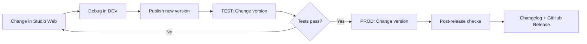

# Release process

How a change moves from **DEV** to **TEST** to **PROD**.

> **Golden rules**
> 1. Only change the automation in **DEV**. Never edit TEST or PROD directly.
> 2. Every change becomes a **new version**. TEST and PROD only receive versions.
> 3. **Do not duplicate** the solution to make an update. Duplicating creates a new package that the existing deployments cannot upgrade to. Duplicate only to start a new tool.

---

## 1. Develop in DEV

1. Open the solution in **Studio Web**. Only one person can edit at a time (edit lock), so agree who works on it.
2. Make the change in the right workflow, for example `CreatePolicies.xaml`. `Run-All.xaml` calls the other workflows based on the options ticked in the app.
3. Test with **Debug**. Debug runs against the Datto RMM **test environment**, never against a customer.

## 2. Publish a new version

1. Click **Publish**.
2. Deployment: **KaseyaTool-DEV**.
3. Raise the version number (see [Versions](../README.md#versions)):
   - bug fix → PATCH (`1.1.2` → `1.1.3`)
   - new option → MINOR (`1.1.2` → `1.2.0`)
   - change that alters how the tool works → MAJOR (`1.1.2` → `2.0.0`)
4. Fill in the **release notes**. They are the version history inside UiPath.
5. Click **Pack and upgrade**.

## 3. Release to TEST

1. Orchestrator → **Solutions → Deployments**.
2. On **KaseyaTool-TEST**, click **⋮ → Change version** and choose the new version.
3. Check the configuration screen: the data bucket asset must point to the **non-production** data bucket.
4. **Validate → Deploy → Activate**.

### Test checklist

- [ ] Every changed option runs and shows **Done**
- [ ] Run each option **twice**: the second run must not create duplicates
- [ ] **Base** and **Base + K365** both work
- [ ] A wrong token gives a clear error
- [ ] The run log is complete and readable
- [ ] The job ran on the **TEST** robot (Monitoring → Jobs → Execution environment)

## 4. Release to PROD

1. On **KaseyaTool-PROD**, click **⋮ → Change version** and choose the same version.
2. Check the configuration screen: the data bucket asset must point to the **Live** data bucket.
3. **Validate → Deploy → Activate**.

## 5. Post-release checks (PROD)

- [ ] **Assets:** the data bucket asset is still the Live bucket
- [ ] **Machines:** only the PROD robot machine is assigned. Remove *Default Serverless* if a deployment added it again
- [ ] **Manage access:** the robot account and the user groups are still assigned
- [ ] **Test run:** start one small run from the PROD app and check that it ran on the PROD robot

## 6. Document and announce

1. Add an entry at the top of `CHANGELOG.md` on the product branch.
2. Create a **GitHub Release** with the release template on the product branch. Tag format: `rmm-v1.2.0` or `noc-v1.2.0`.
3. Tell the consultants that the new version is live, with a link to the release.

---

## The app

The app is published separately from the automation:

- **Automation changes** (workflows) go through the steps above.
- **App changes** (pages, buttons, texts) are made in **App Studio**, published as a new app version, and then updated in each folder under **Automations → Apps**.

After an app change in PROD, check that **Start** still points to the PROD process and that the **Execution Target** is the PROD robot account and machine.

---

## Rollback

Something wrong after a release? Go to **Solutions → Deployments**, click **⋮ → Change version** on the affected environment and choose the **previous** version. Then repeat the post-release checks and open a bug report describing what went wrong.
