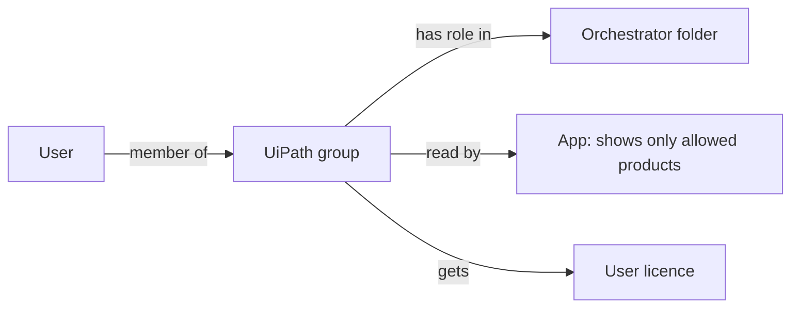

# Roles and permissions

Who can open what, and how to give someone access.

---

## How access works

Access is built in three layers:

1. **Group → folder role** decides **whether** someone can open the app and start a run.
2. **Group → app** decides **what** someone sees inside the app. The app reads the user's groups and hides products that do not belong to them.
3. **Group → licence** gives every member a user licence automatically.

Always give access through a **group**, not to a single person. Adding someone to a group is the only step needed.

---

## Groups

| Group | For | Sees in the app |
|---|---|---|
| `KaseyaTool-Admin` | Tool owners and administrators | Everything |
| `KaseyaTool-DattoRMM` | Consultants doing DattoRMM onboardings | DattoRMM |
| `KaseyaTool-NOC` | Consultants doing NOC onboardings | NOC |

New product? Add a new group with the same prefix, for example `KaseyaTool-ITGlue`.

---

## Folder roles

| Folder | `KaseyaTool-Admin` | Product groups | Robot account |
|---|---|---|---|
| **KaseyaTool-PROD** | Folder Administrator | Automation User | Automation User |
| **KaseyaTool-TEST** | Folder Administrator | – (testers: Automation User) | Automation User |
| **KaseyaTool-DEV** | Folder Administrator | – | Automation User |
| **KaseyaTool-Data** | Folder Administrator | – | Read access to the data buckets |

**Automation User** allows a user to view processes and apps and to start jobs. It does not allow changing processes, assets or bucket files.

To check what a role contains: Orchestrator → **Tenant → Manage access → Roles** → click the role.

---

## Licences

Product groups receive a **Basic** user licence through a group allocation rule (Admin → Licenses → License allocations to groups). Basic includes access to Apps, which is all a consultant needs.

Developers who edit the automation need a licence that includes Studio.

---

## Common tasks

### Give a consultant access

1. Admin → **Accounts & local groups → Local groups**.
2. Open the product group, for example `KaseyaTool-DattoRMM`, and click **Edit**.
3. Add the person under **Members** and save.
4. Ask them to sign out and sign in again.

### Give a developer access

1. Add them to `KaseyaTool-Admin`, or give them **Automation Developer** in **KaseyaTool-DEV**.
2. Share the solution in Studio Web: **Viewer** to read, **Editor** to change.

### Remove access

Remove the person from the group. Their licence becomes available again automatically.

---

## Open points

- Some built-in groups inherit access from the parent **Shared** folder. This means that members of those groups can also open the app. This is being reviewed.
